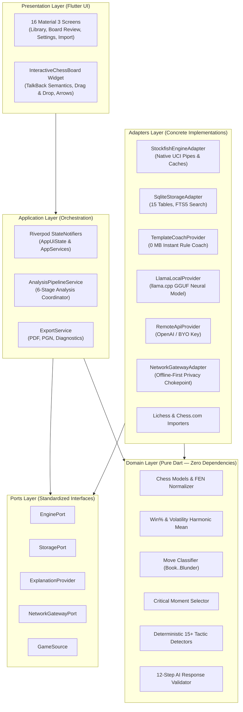

# 🏛️ Architecture Overview — Hexagonal Design in MoveMentor

Welcome to the architectural blueprint of **MoveMentor**! If you are a beginner or looking to understand modern, clean software architecture, this document will explain how the entire application is structured, why this pattern was chosen, and how every piece fits together.

---

## 1. What is Hexagonal Architecture (Ports & Adapters)?

Most beginner tutorials build apps using simple patterns like **MVC (Model-View-Controller)** or put all their logic right inside UI buttons and screens. While that works for small toy apps, it quickly becomes messy in real-world applications where you have databases, chess engines, network requests, and AI models.

MoveMentor is built on **Hexagonal Architecture** (also known as **Ports and Adapters**, invented by Alistair Cockburn). 

### The Core Idea: The "Plug and Socket" Analogy
Imagine a gaming console (like a Nintendo Switch or PlayStation):
- **The Core Console (Domain Layer)** runs the game logic. It doesn't care whether you use a television screen, a handheld screen, a wireless controller, or a wired arcade stick.
- **The Sockets (Ports)** are the standardized USB or HDMI ports on the console. They define *what* signals can go in or out.
- **The Plugs & Accessories (Adapters)** are the specific HDMI cables, TV screens, or controllers. If your TV breaks, you plug in a new monitor—you don't throw away the game console!

In MoveMentor:
- **Chess rules, rating formulas, and tactic detection** are the console (Domain).
- **Abstract interfaces** like `ExplanationProvider` or `StoragePort` are the sockets (Ports).
- **Stockfish binary, SQLite database, and Flutter widgets** are the interchangeable plugs (Adapters).

---

## 2. System Architecture Diagram

---

## 3. The 5 Distinct Layers Explained

### 1. Domain Layer (`lib/src/domain/`)
- **What it is**: The pure mathematical, rule-based heart of chess.
- **Dependencies**: **ZERO external dependencies**. No Flutter, no SQLite, no internet, no Stockfish binary.
- **Key Files**:
  - [`chess_models.dart`](file:///d:/MoveMentor/lib/src/domain/chess/chess_models.dart): Immutable representations of games, positions, moves, and classifications.
  - [`win_accuracy_calculator.dart`](file:///d:/MoveMentor/lib/src/domain/analysis/win_accuracy_calculator.dart): Exact mathematical curves converting engine centipawns to win percentages and harmonic-mean accuracies.
  - [`tag_detector.dart`](file:///d:/MoveMentor/lib/src/domain/tags/tag_detector.dart): 15+ deterministic tactical motif finders (forks, pins, hanging pieces, mate threats) using board geometry and Static Exchange Evaluation (`SeeEvaluator`).
  - [`response_validator.dart`](file:///d:/MoveMentor/lib/src/domain/coach/response_validator.dart): 12-step validation pipeline ensuring no AI coach can ever output illegal moves, polarity contradictions, or shaming language.

### 2. Ports Layer (`lib/src/ports/`)
- **What it is**: The contracts and interfaces that specify *what* capabilities the application needs, without saying *how* they are implemented.
- **Key Files**:
  - [`ports.dart`](file:///d:/MoveMentor/lib/src/ports/ports.dart):
    - `ExplanationProvider`: Any AI engine must implement `.explain(CoachRequest)` and `.check()`.
    - `GameSource`: Any platform importer (Lichess, Chess.com, PGN) must yield a `Stream<ImportProgressUpdate>`.
    - `NetworkGatewayPort`: Enforces network access boundaries and audit logging.

### 3. Adapters Layer (`lib/src/adapters/`)
- **What it is**: The bridge between the outside world (databases, operating system processes, APIs) and the application's ports.
- **Key Files**:
  - [`stockfish_engine_adapter.dart`](file:///d:/MoveMentor/lib/src/adapters/engine/stockfish_engine_adapter.dart): Talks to the native Stockfish 16.1 engine over UCI stdin/stdout pipes.
  - [`sqlite_storage_adapter.dart`](file:///d:/MoveMentor/lib/src/adapters/storage/sqlite_storage_adapter.dart): Interacts with SQLite using 15 relational tables and FTS5 full-text search.
  - [`template_coach_provider.dart`](file:///d:/MoveMentor/lib/src/adapters/providers/template_coach_provider.dart): The default built-in 0 MB coach that composes structured explanations without requiring any downloaded model weights.
  - [`network_gateway_adapter.dart`](file:///d:/MoveMentor/lib/src/adapters/network/network_gateway_adapter.dart): The single privacy chokepoint that blocks network calls when "Offline-only" mode is active.

### 4. Application Layer (`lib/src/application/`)
- **What it is**: The orchestrators and coordinators that guide data through business workflows.
- **Key Files**:
  - [`analysis_pipeline_service.dart`](file:///d:/MoveMentor/lib/src/application/analysis_pipeline_service.dart): Runs the 6-stage analysis pipeline (Engine $\rightarrow$ Win% $\rightarrow$ Classification $\rightarrow$ Critical Moments $\rightarrow$ Tags $\rightarrow$ Coaching).
  - [`app_state.dart`](file:///d:/MoveMentor/lib/src/application/app_state.dart): State management via Riverpod (`AppUiState` and `AppUiNotifier`).
  - [`export_service.dart`](file:///d:/MoveMentor/lib/src/application/export_service.dart): Generates annotated PGN files, PDF game reports, and JSON backups.

### 5. Presentation Layer (`lib/src/presentation/`)
- **What it is**: Everything the user touches, sees, and hears.
- **Key Files**:
  - [`movementor_screens.dart`](file:///d:/MoveMentor/lib/src/presentation/screens/movementor_screens.dart): All 16 primary screens (Onboarding, Library, Game Review, Weakness Dashboard, Model Manager, Settings Hub, etc.).
  - [`chess_board_widget.dart`](file:///d:/MoveMentor/lib/src/presentation/widgets/chess_board_widget.dart): Custom responsive chessboard with best-move arrows, square highlights, and full TalkBack/VoiceOver accessibility support.

---

## 4. Why This Architecture Matters for You

1. **Testability**: Because the domain logic has zero dependencies on Flutter or SQLite, we can run unit tests in milliseconds without launching an Android emulator or database (`flutter test`).
2. **Flexibility**: We can swap Stockfish for another engine, swap SQLite for Drift, or switch from OpenAI to local GGUF models by simply adding an adapter. The core domain code never changes.
3. **Maintainability**: If a bug occurs in Lichess import, we look only in `game_sources_adapter.dart`. If a move classification calculation is off, we look only in `move_classifier.dart`. Each file has exactly one well-defined responsibility.
