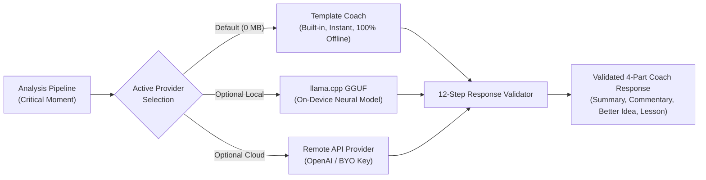

# 🛠️ Tech Stack Deep Dive — Tools, Frameworks & Libraries

Understanding *why* each technology was chosen is just as important as knowing *how* to use it. This guide covers the complete technology stack powering **MoveMentor**, explaining the purpose and architectural role of every key tool and dependency.

---

## 1. Overview of the Tech Stack

| Technology / Tool | Category | Version | Role in MoveMentor |
|---|---|---|---|
| **Flutter & Dart** | Framework & Language | Flutter 3.27+ / Dart 3.6+ | Cross-platform UI and high-performance native compilation |
| **Material 3 (M3)** | Design System | Flutter built-in | Modern accessible mobile UI, dynamic color, contrast tokens |
| **Riverpod** | State Management | `^2.5.1` | Compile-time safe dependency injection and reactive state orchestration |
| **Stockfish 16.1 NNUE** | Chess Engine | C++ Native binary | Superhuman position evaluation and best-move calculation |
| **`chess` (Dart)** | Chess Logic | `^0.8.1` | FEN parsing, move generation, and legal move validation in pure Dart |
| **SQLite + FTS5** | Database | `sqflite ^2.3.3` | Local relational data storage and instant full-text game search |
| **`flutter_secure_storage`**| Security | `^9.2.2` | Hardware-backed keystore encryption for user API keys |
| **`dio`** | Networking | `^5.4.3` | Controlled HTTP requests with strict offline privacy enforcement |
| **`pdf` & `printing`** | Export & Reporting | `^3.10.8` / `^5.12.0` | 100% offline generation of beautiful PDF game reviews |
| **`llama.cpp` / GGUF** | Local Inference | Architecture Ready | Running quantized neural LLMs directly on device RAM |

---

## 2. Framework & Language: Flutter & Dart

### Why Flutter & Dart?
1. **Single Codebase, Native Performance**: Flutter compiles Dart code directly to native ARM64/ARM32 machine code on Android and iOS, as well as x86_64 on desktop. This delivers smooth 60fps/120fps animations when sliding chess pieces across the board.
2. **Rich Canvas & Custom Painting**: The interactive chessboard (`InteractiveChessBoard`) requires drawing custom square highlights, multi-colored best-move arrows, coordinate labels, and tactile feedback. Flutter's `CustomPainter` and widget composition make this straightforward without sluggish web views.
3. **Accessibility First (Semantics)**: MoveMentor makes chess accessible to visually impaired players. Flutter's `Semantics` widget allows every square on the board to be announced by screen readers (e.g., *"White knight on f3"*).

---

## 3. State Management: Riverpod 2.x

MoveMentor uses **Riverpod** (`flutter_riverpod`) for state management and dependency injection.

### Why Riverpod over Provider or Bloc?
- **No `BuildContext` Dependency**: In traditional `Provider`, you can only access dependencies where a `BuildContext` is available. Riverpod providers are globally declared and can be watched or read cleanly anywhere.
- **Compile-Time Safety**: If a provider is missing or wrongly typed, the app fails to compile instead of crashing at runtime.
- **Immutable State Objects**: UI state is held in an immutable data class (`AppUiState`). Whenever state changes (e.g., toggling offline mode, selecting a game), `copyWith(...)` produces a fresh state snapshot, preventing unexpected side-effects.

```dart
// Example from lib/src/application/app_state.dart
final appUiProvider = StateNotifierProvider<AppUiNotifier, AppUiState>((ref) {
  final services = ref.watch(appServicesProvider);
  return AppUiNotifier(services);
});
```

---

## 4. Chess Engine: Stockfish 16.1 NNUE

Stockfish is the world's strongest open-source chess engine.

### How MoveMentor Interacts with Stockfish:
1. **Universal Chess Interface (UCI)**: Stockfish does not run as a Flutter widget; it runs as a native background process. MoveMentor communicates with it via standard input/output (`stdin` and `stdout`) using the UCI protocol.
2. **NNUE (Efficiently Updatable Neural Network)**: Stockfish uses small neural network evaluation functions trained on millions of master games, giving accurate positional evaluations even at shallow depths.
3. **Engine Evaluation Cache**: Every unique board position (identified by its normalized FEN string) is stored in SQLite. If you analyze a game that reaches a position you've seen before, MoveMentor reuses the cached evaluation instantly with **0 ms engine time**!
4. **Thermal Throttling & Thread Protection**: To prevent phones from overheating or draining the battery, the engine is constrained by customizable presets (`fast`, `balanced`, `deep`):
   - Fast: 2 threads, 32 MB hash, ~150 ms per move (depth 12).
   - Balanced: 4 threads, 64 MB hash, ~400 ms per move (depth 16).

---

## 5. Local Storage: SQLite with FTS5

MoveMentor stores all data locally in an offline-first **SQLite** database using the `sqflite` package.

### Why SQLite instead of Hive or SharedPreferences?
- **Relational Integrity**: Chess data is naturally relational:
  - 1 Game $\rightarrow$ Many Positions
  - 1 Position $\rightarrow$ 1 Engine Evaluation
  - 1 Game $\rightarrow$ Many Move Analyses
  - 1 Move Analysis $\rightarrow$ Many Tactical Tags
  SQLite enforces foreign keys and cascading deletes (deleting a game automatically removes all its cached plies and moments).
- **FTS5 (Full-Text Search)**: The `game_fts` virtual table allows instant sub-millisecond searching across thousands of games by player name, opening name, event, or ECO code without lag.
- **Zero Cloud Dependence**: Your chess games, statistics, and notes live in a private SQLite database on your device (`movementor.db`). They are never uploaded to a private server.

---

## 6. The Modular AI Layer

MoveMentor supports three distinct tiers of coaching AI, governed by the `ExplanationProvider` port:



1. **Template Coach (Default)**:
   - Built-in compositional rule engine.
   - **0 MB download**, 100% offline, zero setup.
   - Combines Stockfish evaluations with 15+ deterministic tactical motif tags and player rating bands (Novice, Intermediate, Advanced, Master).
2. **Local GGUF Models (Optional)**:
   - Uses quantized model architectures (like Qwen 0.6B / 1.7B) via `llama.cpp`.
   - Runs on-device neural inference using CPU/RAM with zero cloud data transmission.
3. **Remote API (Optional)**:
   - For users with an OpenAI or Anthropic API key who want cloud LLM analysis.
   - API keys are encrypted locally using `flutter_secure_storage` (Android KeyStore / iOS Keychain).

---

## 7. Network Gateway & Offline Privacy

All network communication (Lichess API, Chess.com API, Remote AI) is routed through a single chokepoint: [`NetworkGatewayAdapter`](file:///d:/MoveMentor/lib/src/adapters/network/network_gateway_adapter.dart).

- **Global Offline Switch**: When "Offline-only Mode" is active (enabled by default), the gateway immediately blocks all outgoing HTTP connections.
- **Local Audit Log**: Whenever an online request is made, the gateway records `(host, purpose, sizeBytes, timestamp)` in a local audit table. It **never** logs payload contents, player names, or API keys.
- **Polite Rate Limiting**: Implements automatic HTTP 429 backoff (e.g., pausing $\ge 60$ seconds with live countdowns) to respect Lichess and Chess.com server policies.
