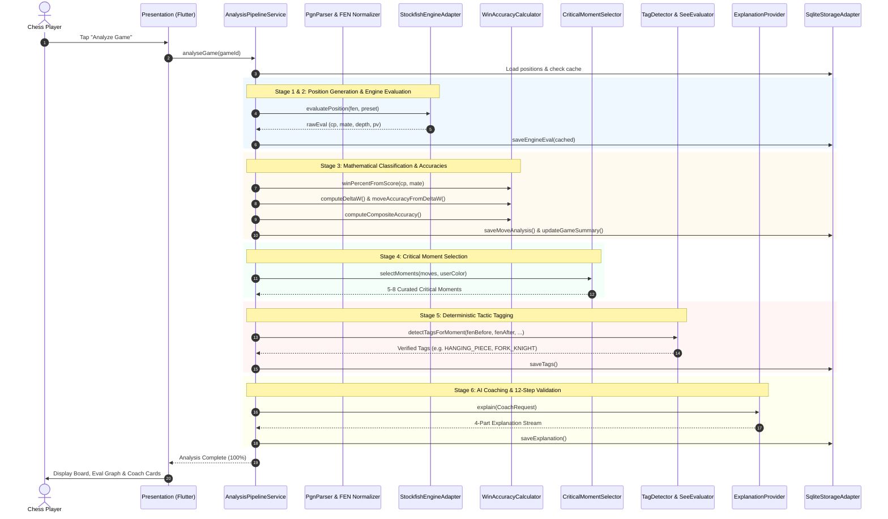

# ⚡ Pipeline & Data Flow — The 6 Stages of Chess Analysis

How does a raw chess move like `1. e4 e5 2. Nf3 Nc6` turn into a comprehensive educational report with win graphs, tactical tags, and personalized coaching? 

This document traces the exact journey of a game through the **6-Stage MoveMentor Analysis Pipeline** (`AnalysisPipelineService`).

---

## 1. High-Level Pipeline Sequence Diagram

---

## 2. Deep Dive: The 6 Pipeline Stages

### Stage 1: Ingestion & Normalization
- **What happens**: The raw PGN string or API payload is parsed by [`PgnParser`](file:///d:/MoveMentor/lib/src/domain/chess/pgn_parser.dart).
- **FEN Normalization**: Chess board FEN strings can include "fake" en-passant squares (e.g., claiming an en-passant target square exists even when no enemy pawn can capture it). [`FenNormalizer`](file:///d:/MoveMentor/lib/src/domain/chess/fen_normalizer.dart) strips invalid en-passant flags so identical physical positions always produce identical cryptographic hashes (`positionKey`), maximizing engine cache hits.

---

### Stage 2: Stockfish Engine Pass
- **What happens**: MoveMentor iterates through all plies of the game.
- **Cache Check**: For each position, the SQLite database is checked first. If the position has been evaluated before, MoveMentor reuses the evaluation with **zero CPU usage**.
- **Engine Calculation**: If un-cached, Stockfish calculates:
  - `cp`: Evaluation in centipawns (100 centipawns = 1 pawn advantage).
  - `mate`: Distance to forced checkmate (e.g., `+3` = White mates in 3 moves).
  - `pv`: Principal Variation (the engine's predicted best line of play).
  - `depth`: Search depth achieved.

---

### Stage 3: Win Equity ($\Delta W$) & Move Classification
- **What happens**: Raw engine centipawns are converted into human-centric win percentages and move labels using [`WinAccuracyCalculator`](file:///d:/MoveMentor/lib/src/domain/analysis/win_accuracy_calculator.dart) and [`MoveClassifier`](file:///d:/MoveMentor/lib/src/domain/analysis/move_classifier.dart).

#### The Mathematical Formulas:
1. **Win Probability Curve**:
   $$W(\text{cp}) = 50 + 50 \cdot \left(\frac{2}{1 + e^{-0.00368208 \cdot \text{cp}}} - 1\right)$$
   - A score of $0$ centipawns $\rightarrow 50\%$ win probability.
   - A score of $+100$ centipawns $\rightarrow \approx 59\%$ win probability.
   - A score of $+400$ centipawns $\rightarrow \approx 87\%$ win probability.
2. **Win Equity Drop ($\Delta W$)**:
   $$\Delta W = W_{\text{before}}(\text{mover}) - W_{\text{after}}(\text{mover})$$
   Measures exactly how much winning chance the player lost with their move.
3. **Move Accuracy**:
   $$\text{Accuracy} = \text{clamp}\left(103.1668 \cdot e^{-0.04354 \cdot \Delta W} - 3.1669, 0, 100\right)$$
4. **Move Classification Thresholds (Lichess Preset)**:
   - **Best / Great / Brilliant**: $\Delta W \le 0.5$ (or exceptional sacrifice that improves position).
   - **Good**: $\Delta W \le 5.0$
   - **Inaccuracy**: $5.0 < \Delta W \le 10.0$
   - **Mistake**: $10.0 < \Delta W \le 20.0$
   - **Blunder**: $\Delta W > 20.0$

---

### Stage 4: Critical Moment Selection
- **What happens**: In an 80-move game, reviewing every move is overwhelming. [`CriticalMomentSelector`](file:///d:/MoveMentor/lib/src/domain/analysis/critical_moment_selector.dart) curates the **5 to 8 most instructive moments** of the game.
- **Scoring Equation**:
  $$S = 1.2 \cdot \Delta W + 15.0 \cdot \text{swing} + \text{specialBonus} + 1.5 \cdot \text{volatility} + \text{missedPunishment}$$
- **Key Rules**:
  - Focuses on the user's side (or both sides if toggled).
  - Guarantees a minimum spacing of 3 plies between moments so reviews don't cluster on consecutive moves.
  - Ensures at least one positive moment (Brilliant or Great move) is included whenever one occurred.

---

### Stage 5: Deterministic Tactic Tagging
- **What happens**: [`TagDetector`](file:///d:/MoveMentor/lib/src/domain/tags/tag_detector.dart) inspects the board position before and after each critical moment.
- **15+ Deterministic Detectors**:
  - `MATE_THREAT`: Forced checkmate within 5 plies.
  - `HANGING_PIECE`: Undefended piece exposed to capture.
  - `FORK_KNIGHT` / `FORK_PAWN`: Single piece attacking two valuable targets.
  - `PIN_ABSOLUTE` / `PIN_RELATIVE`: Piece shielded from moving due to king/queen behind it.
  - `DISCOVERED_CHECK` / `DISCOVERED_ATTACK`: Moving a piece unmasks a line of attack.
  - `BACK_RANK`: King trapped behind pawns on the back rank.
  - `Static Exchange Evaluation (SEE)`: Verifies whether capturing a piece results in a net material gain or loss.

---

### Stage 6: Modular Coaching & 12-Step Validation
- **What happens**: The active coach compiles a structured 4-part explanation:
  1. **S1 (What Happened)**: *"Moving your bishop to b4 walked into a knight fork."*
  2. **S2 (Why It Matters)**: *"This costs you material and turns a winning advantage into an equal game."*
  3. **S3 (Better Idea)**: *"Instead, 14. Be2 would have protected your king and preserved your development."*
  4. **S4 (Lesson)**: *"Always check if the opponent has a jumping knight fork before placing pieces on the same color squares."*
- **Validation**: Passed through [`CoachResponseValidator`](file:///d:/MoveMentor/lib/src/domain/coach/response_validator.dart) to guarantee factual consistency, rating-appropriate vocabulary, and zero hallucinated moves.
