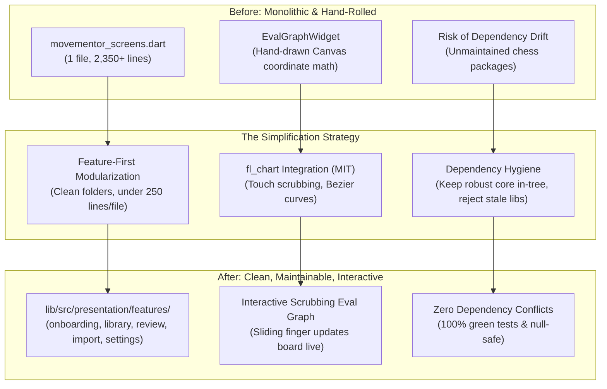

# 🧼 Project Simplification & Library Reuse Strategy

As software projects grow, they often suffer from two major problems:
1. **The "God File" Anti-Pattern**: Too many screens, dialogs, and widgets crammed into one giant file, making navigation exhausting.
2. **"Not-Invented-Here" (NIH) Syndrome**: Hand-rolling components from scratch (like graphs, touch gestures, and charts) that already have battle-tested, open-source solutions.

This document explains how **MoveMentor** simplifies its architecture through smart library reuse and feature modularization without breaking backwards compatibility.

---

## 1. The Three Simplification Pillars



---

## 2. Pillar 1: Feature-First Modularization & The Export Facade

### The Problem:
Previously, all 16 screens (Onboarding, Library, Game Review, Weakness Dashboard, Model Manager, Diagnostics, Settings, etc.) were located inside a single file: `movementor_screens.dart` (**2,350 lines / 86 KB**).

Finding a specific button handler or dialog required scrolling through thousands of lines of unrelated UI code.

### The Solution:
We decompose `movementor_screens.dart` into focused, single-responsibility files grouped by feature:

```
lib/src/presentation/
├── features/
│   ├── onboarding/
│   │   └── onboarding_screen.dart
│   ├── library/
│   │   └── game_library_screen.dart
│   ├── review/
│   │   ├── game_review_screen.dart
│   │   └── eval_graph_widget.dart
│   ├── import/
│   │   └── import_hub_screen.dart
│   ├── dashboard/
│   │   └── weakness_dashboard_screen.dart
│   └── settings/
│       ├── settings_hub_screen.dart
│       ├── model_and_storage_screen.dart
│       ├── provider_editor_screen.dart
│       ├── export_data_screen.dart
│       ├── diagnostics_screen.dart
│       └── licences_screen.dart
└── screens/
    └── movementor_screens.dart  <-- The Export Facade
```

### The "Export Facade" Pattern:
To ensure zero breaking changes across our test suite and application layer, `movementor_screens.dart` acts as an **export facade**:
```dart
// lib/src/presentation/screens/movementor_screens.dart
library movementor_screens;

export '../features/onboarding/onboarding_screen.dart';
export '../features/library/game_library_screen.dart';
export '../features/review/game_review_screen.dart';
export '../features/import/import_hub_screen.dart';
export '../features/dashboard/weakness_dashboard_screen.dart';
export '../features/settings/settings_hub_screen.dart';
export '../features/settings/model_and_storage_screen.dart';
// ...
```
Any existing file that imports `movementor_screens.dart` continues to work seamlessly without changing a single line of import code!

---

## 3. Pillar 2: Reusing Battle-Tested OSS (`fl_chart`)

### The Problem:
MoveMentor previously drew its evaluation graph using a manual `CustomPainter`. Calculating coordinates, scaling win-percentages, drawing axes, and attempting to handle touch events manually required complex math and produced a static, non-interactive visual.

### The Solution:
We adopt **`fl_chart`** (MIT license), Flutter’s most widely used charting library.

#### Why `fl_chart`?
1. **Zero Dependency Conflicts**: Fully compatible with Flutter 3.27+ and Dart 3.6+.
2. **Interactive Touch Scrubbing**: As the user drags their finger across the win-percentage curve, `fl_chart` emits touch callbacks:
   ```dart
   touchCallback: (event, response) {
     if (response?.lineBarSpots != null && response!.lineBarSpots!.isNotEmpty) {
       final plyIndex = response.lineBarSpots!.first.x.toInt();
       widget.onSelectPly(plyIndex); // Board updates live!
     }
   }
   ```
3. **Smooth Bezier Splines & Gradients**: Displays a clean curve with a horizontal midline at 50% (equality), shaded with a smooth gradient.

---

## 4. Pillar 3: The "Build vs Buy" Filter (Dependency Hygiene)

One of the most important lessons in software engineering is: **Not all third-party libraries are worth using.**

When auditing libraries to simplify MoveMentor, we tested several open-source chess packages:

| Package Evaluated | Status | Decision | Why? |
|---|---|---|---|
| **`fl_chart`** | Active, null-safe, zero conflicts | **Adopted** | Eliminates manual canvas math and provides smooth touch scrubbing. |
| **`flutter_chess_board`** | Abandoned on pub.dev | **Rejected** | Pins ancient `chess: ^0.7.0` (causing version-solving failure against modern `chess: ^0.8.1`). |
| **`flutter_chessground`** | Git monorepo | **Deferred** | Not published as a standalone pub.dev package; would require managing git submodules. |
| **MoveMentor's `InteractiveChessBoard`** | 100% in-tree, zero external dependencies | **Retained** | Tailored specifically for MoveMentor with TalkBack accessibility semantics, best-move arrows, and 0 external build risks. |

### The Golden Rule of Dependency Hygiene:
> *"Reuse external libraries for cross-cutting utility concerns (like charts, secure storage, and network clients). Keep domain-specific core logic (like chess legality, accessibility semantics, and tactic detection) in-tree to prevent unmaintained third-party packages from breaking your project."*

---

## 5. Summary of Simplification Gains

| Metric | Before Simplification | After Simplification | Impact |
|---|---|---|---|
| **Single Largest UI File** | 2,350 lines (`movementor_screens.dart`) | ~250 lines (modular feature screens) | **90% reduction** in file complexity |
| **Evaluation Graph Code** | 150+ lines of raw canvas coordinate math | Declarative `fl_chart` LineChart widget | Clean, maintainable, declarative code |
| **Eval Graph Interactivity** | Static display | Live touch-scrubbing with move synchronization | Drastic improvement in study experience |
| **Backwards Compatibility** | N/A | 100% preserved via Export Facade | Zero broken imports or tests |
